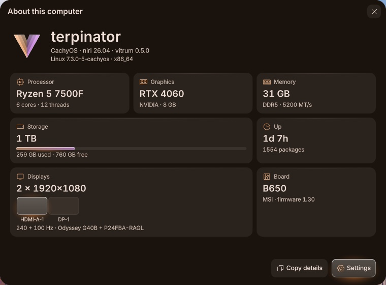

<p align="center">
  
</p>

<h1 align="center">vitrum</h1>

<p align="center">
  A glass desktop for <a href="https://github.com/YaLTeR/niri">niri</a>, coloured by your wallpaper and lit from within.
</p>

<p align="center">
  <a href="https://github.com/LanisOff/vitrum-shell/stargazers"></a>
  <a href="https://github.com/LanisOff/vitrum-shell/commits/main"></a>
  <a href="https://github.com/LanisOff/vitrum-shell/commits/main"></a>
  <a href="https://github.com/LanisOff/vitrum-shell/issues"></a>
  <a href="LICENSE"></a>
</p>

<p align="center">
  <a href="https://github.com/YaLTeR/niri"></a>
  <a href="https://quickshell.org"></a>
  
  
  
  
  
</p>

<p align="center">
  
</p>

vitrum is the whole desktop you see after logging in. A bar of floating
islands, a dock, search, a control centre, widgets, a lock screen and a
settings app, all on real refracting glass. It started as my own setup. It's still young, so
please [open an issue](https://github.com/LanisOff/vitrum-shell/issues)
when something breaks.

<p align="center">
  <a href="#previews">Previews</a> ·
  <a href="#whats-inside">What's inside</a> ·
  <a href="#install">Install</a> ·
  <a href="#update">Update</a> ·
  <a href="#remove">Remove</a>
</p>

---

## Previews

<table>
  <tr>
    <td width="50%"></td>
    <td width="50%"></td>
  </tr>
  <tr>
    <td align="center"><sub>Dark and calm, on a moon wallpaper</sub></td>
    <td align="center"><sub>Light, for the day: agenda, habits, stopwatch</sub></td>
  </tr>
  <tr>
    <td width="50%"></td>
    <td width="50%"></td>
  </tr>
  <tr>
    <td align="center"><sub>Control centre, what is on lit inside the glass</sub></td>
    <td align="center"><sub>Notifications, grouped by app</sub></td>
  </tr>
  <tr>
    <td width="50%"></td>
    <td width="50%"></td>
  </tr>
  <tr>
    <td align="center"><sub>Lock screen, with the player and lyrics</sub></td>
    <td align="center"><sub>kitty, fastfetch and btop in the same colours</sub></td>
  </tr>
</table>

<table>
  <tr>
    <td width="50%"></td>
    <td width="50%"></td>
  </tr>
  <tr>
    <td align="center"><sub>Settings, Appearance page</sub></td>
    <td align="center"><sub>About this computer, as spec tiles</sub></td>
  </tr>
</table>

---

## What's inside

> [!NOTE]
> **New in 0.5.0:** vitrum's own glass look instead of Material 3, a drag-and-drop bar editor, a reworked lock screen, a welcome tour, About this computer as spec tiles, new desktop widgets, and optional Steam and Vesktop themes that follow your colours.

### Desktop

- A bar of floating islands, a dock, Spotlight-style search, a control centre and notifications.
- 40 desktop widgets, from clocks and weather to system graphs and a to-do list, now with an agenda, habits, a stopwatch, the moon, air quality, headlines and top processes. Add your own in QML or as a script, and arrange them right on the desktop.
- A bar editor in Settings. Drag modules between islands and sides on a live bar, pick from a palette of named modules, set each one's options, give each screen its own layout, or reset.
- A reworked lock screen. The field lights up as you type, Caps Lock gets a hint, your avatar sits in a coloured ring, and it goes quiet when idle.
- Game mode turns on by itself when a game goes fullscreen. Video wallpapers pause under windows.

### Apps

- Settings for everyday changes, so config files stay optional.
- About this computer, redone as spec tiles.
- A welcome tour on first login, with a live preview of each part of the desktop.
- Clipboard history, screenshots and recording, synced lyrics, hot corners, a polkit prompt and a login screen that match.

### Theming

- vitrum's own look replaces Material 3. Anything that's on turns to frosted, lit glass with a soft glow in your accent. No pill shapes, thin Phosphor line icons, and calm motion with no bounce.
- Colours from your wallpaper for the shell, kitty, GTK, Qt/KDE, tmux and Neovim, light or dark by sunrise and sunset.
- A second colour drawn from the accent for rings, graphs and the window focus ring. Shift it in Settings → Appearance.
- Optional Steam (via Millennium) and Vesktop (Discord) themes that follow your colours. Both are installer choices with a section in Settings.
- fastfetch fits narrow terminals and tmux splits.

### Under the hood

- niri 26.04, patched with liquid glass and shaped blur. Choose solid, frosted or glass per surface if your GPU prefers.
- A [Quickshell](https://quickshell.org) shell, one installer for four distributions, and `vitrum doctor` when something's off.

---

## Install

```sh
curl -fsSL https://raw.githubusercontent.com/LanisOff/vitrum-shell/main/get.sh | bash
```

This installs git if needed, clones vitrum to `~/.local/share/vitrum-src`
and starts the installer. Or by hand:

```sh
git clone https://github.com/LanisOff/vitrum-shell
cd vitrum-shell
./install.sh
```

> [!IMPORTANT]
> Runs on Arch with systemd (CachyOS and other Arch-based systems too),
> Gentoo with OpenRC or systemd, Fedora 43 or newer with systemd (tested on
> 44), and Void (glibc, not musl) with runit and elogind. NVIDIA works.

> [!NOTE]
> The installer backs up every file it replaces, and asks before it makes
> fish your login shell or replaces another login screen. NetworkManager
> takes over the network. On Fedora it enables RPM Fusion and a few COPRs,
> and tells you which. On Void the login screen and network switch over at
> the next boot. On Gentoo the first run is slow, because niri and some Qt
> pieces build from source.

> [!TIP]
> A minimal Void may lack bash, curl and sudo. Run
> `xbps-install -Sy bash curl sudo` as root, then add yourself to `wheel`
> (`usermod -aG wheel <you>`, with the `%wheel` line enabled in `visudo`).

You pick the parts on one screen. Desktop has the login screen, boot
splash, video wallpapers and KDE Connect. Tools has tmux, game mode, the
Steam theme (needs game mode), the Vesktop theme, the mic filter, VPN, CLI
tools, Dolphin and OCR. Extras holds my own Neovim and tmux setup, off by
default. If a stage fails, you can retry it, skip it, read its log, or
carry on later with `./install.sh --from <stage>`. Logs go to
`~/.local/share/vitrum/`.

```sh
./install.sh --dry-run   # show what it would do, change nothing
./install.sh --update    # update: ask only about parts new or still unticked
./install.sh --choose    # the choice screen again, with your choices
./install.sh --fresh     # the first-run screens again; everything is redone
./install.sh --doctor    # check an existing install
./install.sh --yes       # no screens: earlier answers, defaults for new parts
./install.sh --help      # every flag, one per part (--with-games, --no-ocr...)
```

Every part has its own flags, such as `--with-steam-theme` and
`--with-vesktop-theme`. They also pass through the one-liner:

```sh
curl -fsSL https://raw.githubusercontent.com/LanisOff/vitrum-shell/main/get.sh | bash -s -- --dry-run
```

Once you're in:

| Key | Opens |
|---|---|
| `Mod+Space` | Search |
| `Mod+Alt+C` | Control centre |
| `Mod+Comma` | Settings |
| `Mod+Alt+W` | Widget editor |
| `Mod+/` | Every shortcut |

The rest is in [KEYBINDS.md](KEYBINDS.md). Settings are also plain text in
`~/.config/vitrum/settings.json`.

---

## Update

```sh
vitrum update           # pull and reinstall only what changed
vitrum update --choose  # the same, with the choice screen to change your parts
vitrum rollback         # undo the last update (your configs are snapshotted first)
vitrum doctor           # find out what is broken and how to fix it
```

Your choices are kept. You're only asked about parts that are new or still
unticked. A small island in the bar tells you when there's something to pull.

---

## Remove

```sh
./uninstall.sh
```

This undoes what the installer added and restores the files it backed up.
Packages, `~/.config/vitrum` and `~/.local/share/vitrum` stay. `--purge`
removes the last two. The clone in `~/.local/share/vitrum-src` is yours to
delete. NetworkManager stays in charge of the network.

---

## Credits

- [niri](https://github.com/YaLTeR/niri) by YaLTeR, the compositor underneath.
- [Niri-glass](https://github.com/YeFaDa/Niri-glass) by YeFaDa, the liquid glass it's patched with.
- [Quickshell](https://quickshell.org), which the shell is written in.
- [matugen](https://github.com/InioX/matugen), which turns the wallpaper into a palette.
- [Phosphor Icons](https://phosphoricons.com), the line icons.
- [Bibata](https://github.com/ful1e5/Bibata_Cursor), the cursor.
- Default wallpapers from [Wallhaven](https://wallhaven.cc/).

<a href="https://star-history.com/#LanisOff/vitrum-shell&Date">
  <picture>
    <source media="(prefers-color-scheme: dark)" srcset="https://api.star-history.com/svg?repos=LanisOff/vitrum-shell&type=Date&theme=dark">
    
  </picture>
</a>

---

## License

[GPL-3.0](LICENSE)
