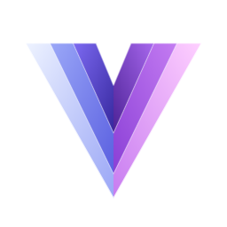
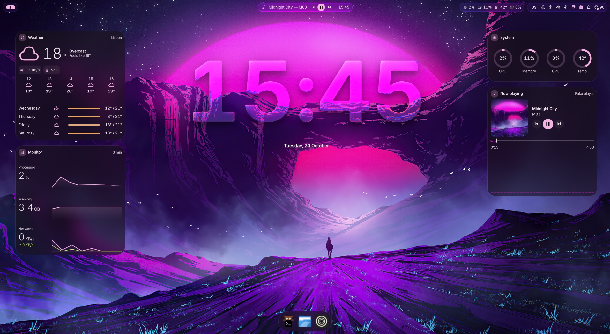
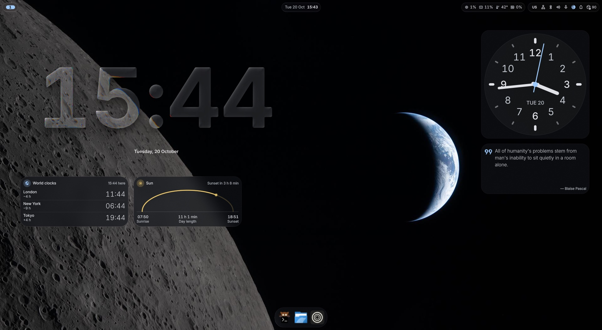
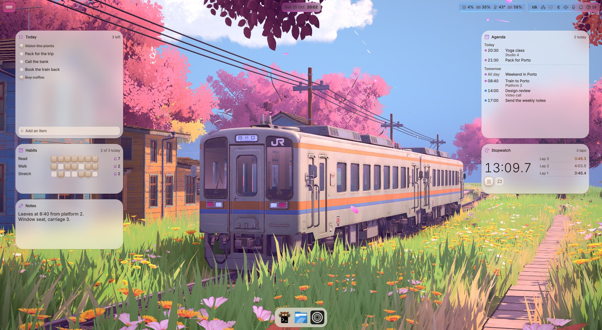
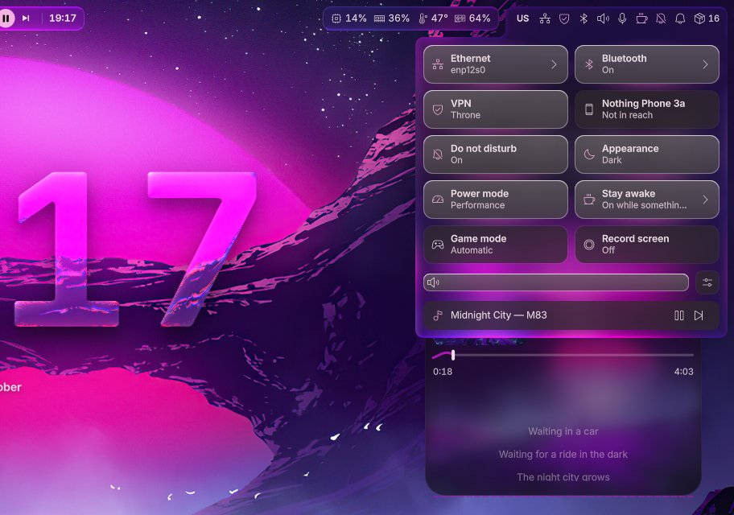
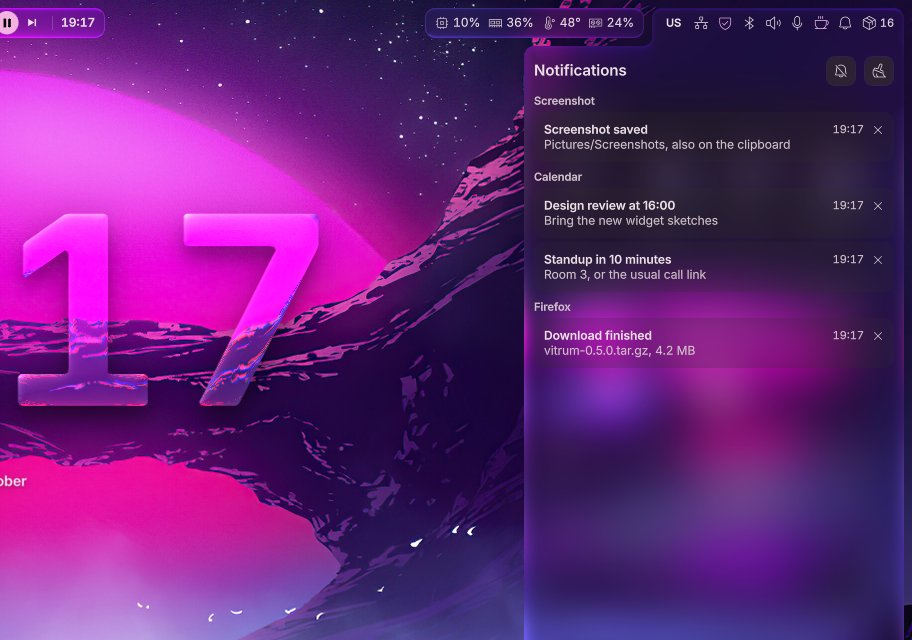
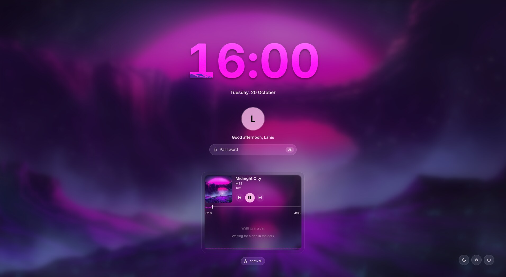
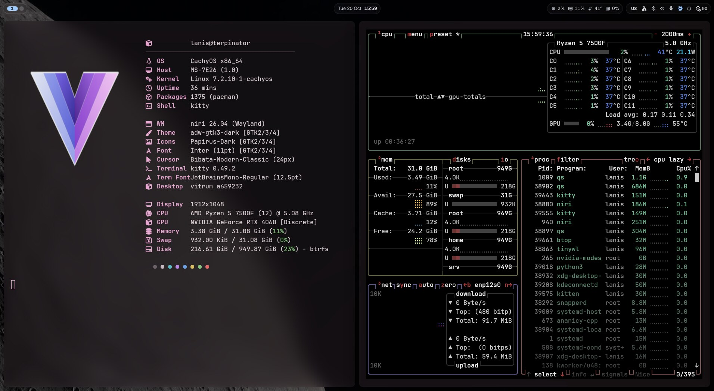
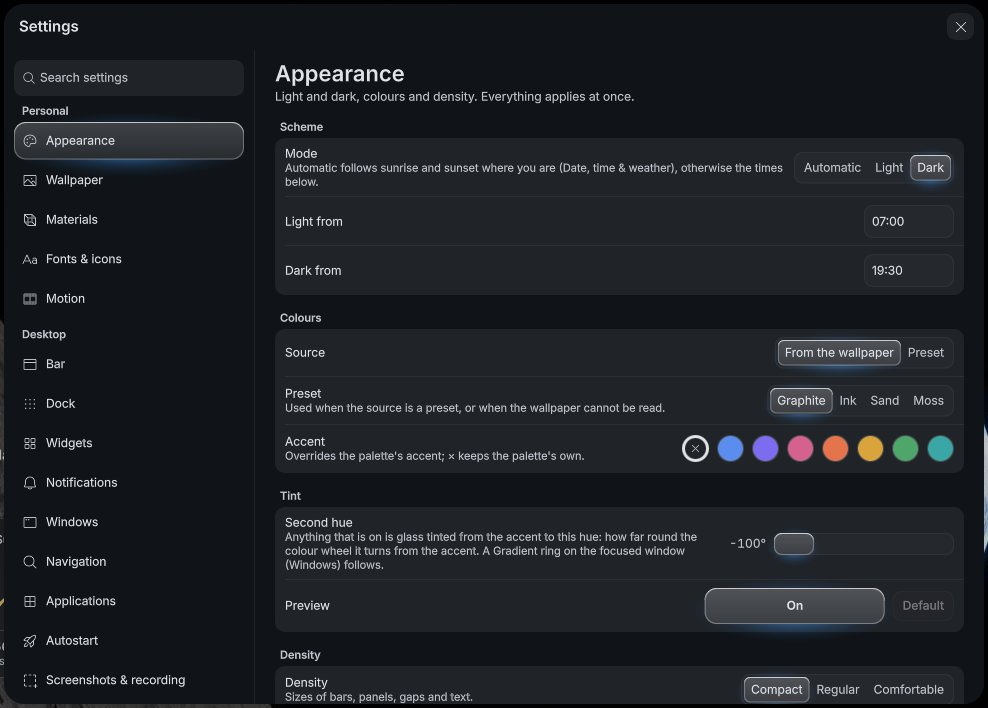

<p align="center">
  
</p>

<h1 align="center">vitrum</h1>

<p align="center">
  A glass desktop for <a href="https://github.com/YaLTeR/niri">niri</a>.
</p>

<p align="center">
  <a href="https://github.com/LanisOff/vitrum-shell/stargazers"></a>
  <a href="https://github.com/LanisOff/vitrum-shell/commits/main"></a>
  <a href="https://github.com/LanisOff/vitrum-shell/commits/main"></a>
  <a href="https://github.com/LanisOff/vitrum-shell/issues"></a>
  <a href="LICENSE"></a>
</p>

<p align="center">
  <a href="https://github.com/YaLTeR/niri"></a>
  <a href="https://quickshell.org"></a>
  
  
  
</p>

<p align="center">
  
</p>

vitrum is the whole thing you see after logging in: a bar made of floating
islands, a dock, Spotlight-style search, a control centre, notifications,
desktop widgets, a lock screen and a settings app, all on real refracting
glass. It runs on a patched niri (liquid glass, shaped blur) with a
[Quickshell](https://quickshell.org) shell on top, and its colours come from
your wallpaper.

It started as my own setup and grew into something that installs cleanly on
a fresh machine. It is still young: expect rough edges, and please
[open an issue](https://github.com/LanisOff/vitrum-shell/issues) when you hit one.

<p align="center">
  <a href="#screenshots">Screenshots</a> ·
  <a href="#what-you-get">What you get</a> ·
  <a href="#install">Install</a> ·
  <a href="#keep-it-up-to-date">Updating</a> ·
  <a href="#using-it">Using it</a> ·
  <a href="#removing-it">Removing it</a>
</p>

## Screenshots

Every picture below is the shell as it is in the repository, taken in a
nested niri session.

### One desktop, many faces

The palette follows the wallpaper, light or dark, and the widgets are yours
to arrange: right-click a widget, or press `Mod+Alt+W`, to open the editor.

<table>
  <tr>
    <td width="50%"></td>
    <td width="50%"></td>
  </tr>
  <tr>
    <td align="center"><sub>Dark, minimal: glass clock, world clocks, sun, analog clock, quote</sub></td>
    <td align="center"><sub>Light, for the day: to-do, notes, shortcuts, calendar, timer, countdown</sub></td>
  </tr>
</table>

### Control centre and notifications

<table>
  <tr>
    <td width="50%"></td>
    <td width="50%"></td>
  </tr>
  <tr>
    <td align="center"><sub>Quick toggles, volume and the player, one click from the bar</sub></td>
    <td align="center"><sub>Notifications, grouped by app</sub></td>
  </tr>
</table>

### Lock screen

<p align="center">
  
  <br><sub>The wallpaper, blurred; the clock in glass; the player and its lyrics stay at hand</sub>
</p>

### Windows and settings

<p align="center">
  
  <br><sub>kitty and the terminal tools take the same palette as the shell</sub>
</p>

<p align="center">
  
  <br><sub>A settings app for everyday changes, no config files needed</sub>
</p>

## What you get

| | |
|---|---|
| **Glass everywhere** | The bar, panels, dock and menus refract what is behind them. Pick solid, frosted or glass per surface if your GPU prefers. |
| **Colours from the wallpaper** | kitty, GTK, Qt/KDE apps, tmux and Neovim follow the same palette, light or dark by sunrise and sunset. |
| **Desktop widgets** | 26 of them, from clocks, weather and a calendar to system graphs, a player, notes and a to-do list, plus your own in QML or as a script. Placed and sized in an editor on the desktop itself. |
| **Live wallpapers** | Videos as wallpaper, paused while windows cover them. |
| **Game mode** | Turns on by itself when a game goes fullscreen: the shell gets out of the way, notifications wait, gamemode and MangoHud do their part. |
| **A real settings app** | No config files needed for everyday changes. |
| **The small things** | Clipboard history, screenshots and recording, synced lyrics in the player, hot corners, a polkit prompt and a login screen that look like the rest. |

## Install

Gentoo (OpenRC or systemd) and Arch (systemd) are supported. NVIDIA works.

```sh
git clone https://github.com/LanisOff/vitrum-shell
cd vitrum-shell
./install.sh
```

The installer asks a few questions once (login screen, boot splash, video
wallpapers, extras like game mode), builds niri, sets everything up and
remembers your answers. Useful flags:

```sh
./install.sh --dry-run   # show what it would do, change nothing
./install.sh --doctor    # check an existing install
./install.sh --yes       # no questions, reuse earlier answers
```

On Gentoo the first run takes a while: niri and a few Qt pieces are built
from source.

## Keep it up to date

```sh
vitrum update      # pull and reinstall only what changed
vitrum rollback    # undo the last update (your configs are snapshotted first)
vitrum doctor      # find out what is broken and how to fix it
```

`vitrum update` also puts back packages and fonts that went missing.

The bar shows a small island when the repository is a few commits ahead of
you; click it to see what is new.

## Using it

Everything is reachable from the keyboard: `Mod+/` shows every shortcut,
and [KEYBINDS.md](KEYBINDS.md) has the full list. Settings live in the
Settings app (or `~/.config/vitrum/settings.json` if you prefer text).

## Removing it

```sh
./uninstall.sh
```

It removes what the installer added and restores every file it backed up.
Your settings stay unless you add `--purge`, and packages are left installed:
you may depend on them by now.

## Star history

<a href="https://star-history.com/#LanisOff/vitrum-shell&Date">
  <picture>
    <source media="(prefers-color-scheme: dark)" srcset="https://api.star-history.com/svg?repos=LanisOff/vitrum-shell&type=Date&theme=dark">
    
  </picture>
</a>

## Credits

- [niri](https://github.com/YaLTeR/niri) by YaLTeR, the compositor underneath.
- [Niri-glass](https://github.com/YeFaDa/Niri-glass) by YeFaDa, the liquid glass it is patched with.
- [Quickshell](https://quickshell.org), which the shell is written in.
- Default wallpapers are from [Wallhaven](https://wallhaven.cc/).

## License

[GPL-3.0](LICENSE)
